<picture>
  <source media="(prefers-color-scheme: dark)" srcset="assets/banner-dark.svg">
  
</picture>

Backend and systems engineer, CS student at the University of Passau. I work on data pipelines, storage and sync, mostly in Go, Java and Kotlin, and I am going deeper into distributed systems.

| Where | What |
| --- | --- |
| `element` | Working student since October 2026. |
| `cloudflare` | Intern on Analytics & Alerts. Shipped a compaction path for an analytics pipeline at 100M events/s that merges aggregates during downstream outages, and a fault-injection setup to measure it before rollout. |
| `itestra` | Rewrote about 31K LOC of COBOL insurance batch logic in Java/Quarkus. |
| `check24` | Moved provider calls off the request path onto ActiveMQ, halving P95 response latency. |
| [`aqt-sync`](https://github.com/Aquitano/aqt-sync) | Zero-knowledge file and folder sync in Go: content-defined chunking, two-way sync, snapshots and conflict handling. |
| [`aqt-health`](https://github.com/Aquitano/aqt-health) | Kotlin/Ktor service that reconciles health data from several providers into one PostgreSQL model. |
| [`chill-flow`](https://github.com/Aquitano/chill-flow) | Terminal focus player in Rust. |

[thomasbreindl.me](https://thomasbreindl.me) · [LinkedIn](https://www.linkedin.com/in/thomas-breindl)
